<div align="center">

# Jeevesh Singale

### **AI & Systems Engineer · Voice AI · Agentic RAG · 3D WebGL**
*I build AI systems you can audit: grounded answers, bounded tools, published evals.*

Nottingham, UK &nbsp;•&nbsp; [LinkedIn](https://linkedin.com/in/jeevesh-singale07) &nbsp;•&nbsp; [Portfolio](https://jeevesh-portfolio-website-00.vercel.app/) &nbsp;•&nbsp; [Email](mailto:jeevesh2515@gmail.com) &nbsp;•&nbsp; [Sponsor](https://github.com/sponsors/jeevesh2515)

<br/>

<a href="https://github.com/jeevesh2515?tab=followers"></a> <a href="https://github.com/jeevesh2515?tab=repositories"></a> <a href="https://github.com/jeevesh2515"></a> <a href="https://github.com/sponsors/jeevesh2515"></a> <a href="https://opensource.org/licenses/MIT"></a>

</div>

---

## 🧭 How I Engineer AI Systems

- **Ground the output.** Models only state what a tool or retrieved source supports, or escalate.
- **Bound the agent.** Risk-classed tools, confirmed writes, tenant-scoped queries, fail-closed gates.
- **Measure, then claim.** Every flagship ships tests, evals and a written list of its limits.

---

## ⚡ Featured Engineering & Flagship Architectures

<table width="100%">
  <!-- ROW 1: WWB & PRESSFLICK -->
  <tr>
    <td width="50%" valign="top">
      <h3>🎮 <a href="https://jeevesh2515.github.io/WWB/">World War B: Bugfront</a></h3>
      <p><b>Style-ranked 3D browser FPS, playable live.</b></p>
      <ul>
        <li><b>Engine:</b> Three.js PBR and Rapier3D WASM physics, under 22 MB.</li>
        <li><b>Combat:</b> 8 waves, a boss, 7 style ranks, 8 augment perks.</li>
        <li><b>Duel mode:</b> Supabase Realtime 1v1 with CPU fallback.</li>
      </ul>
      <p>
        <a href="https://jeevesh2515.github.io/WWB/"></a>
        <a href="https://github.com/jeevesh2515/WWB"></a>
        
        
      </p>
    </td>
    <td width="50%" valign="top">
      <h3>🎬 <a href="https://pressflick.vercel.app">Pressflick</a></h3>
      <p><b>Free text match-cut video maker: one word holds, pages change.</b></p>
      <ul>
        <li><b>Export:</b> 1080p MP4 via WebCodecs, WebM fallback, 3 formats.</li>
        <li><b>Private:</b> No backend, account, watermark or tracking.</li>
        <li><b>Verified:</b> 111 E2E checks in 3 engines, zero axe issues.</li>
      </ul>
      <p>
        <a href="https://pressflick.vercel.app"></a>
        <a href="https://github.com/jeevesh2515/pressflick"></a>
        
        
      </p>
    </td>
  </tr>
  <!-- ROW 2: VOXFLOW & FINSENTINEL -->
  <tr>
    <td width="50%" valign="top">
      <h3>🎙️ <a href="https://github.com/jeevesh2515/voxflow-voice-agent-case-study">VoxFlow Voice Agent</a></h3>
      <p><b>Inbound voice agent for logistics desks, in supervised pilot.</b></p>
      <ul>
        <li><b>Pipeline:</b> Connect + Lex V2 &rarr; signed Lambda &rarr; FastAPI on Groq.</li>
        <li><b>Tool safety:</b> 22 identity-scoped tools, 2FA caller checks.</li>
        <li><b>Evidence:</b> 963 tests, a threat model, published limits.</li>
      </ul>
      <p>
        <a href="https://github.com/jeevesh2515/voxflow-voice-agent-case-study"></a>
        <a href="https://www.voxflow.cc/"></a>
        
        
      </p>
    </td>
    <td width="50%" valign="top">
      <h3>🛡️ <a href="https://github.com/jeevesh2515/finsentinel-case-study">FinSentinel AML Engine</a></h3>
      <p><b>Local-first AML investigation with audit-logged cases.</b></p>
      <ul>
        <li><b>Isolation:</b> Postgres RLS and an append-only audit trail.</li>
        <li><b>Speed:</b> Evidence packs 1,070 ms &rarr; 44 ms p50, CI-gated.</li>
        <li><b>Rigour:</b> 771 tests, 29/29 release checks.</li>
      </ul>
      <p>
        <a href="https://github.com/jeevesh2515/finsentinel-case-study"></a>
        <a href="https://finsentinel-chi.vercel.app/"></a>
        
        
      </p>
    </td>
  </tr>
  <!-- ROW 3: CLINICAL RAG & EXPERTIQ -->
  <tr>
    <td width="50%" valign="top">
      <h3>🏥 <a href="https://clinical-workflows.vercel.app">Clinical RAG Agent</a></h3>
      <p><b>Hypertension-care assistant with safety-first guardrails.</b></p>
      <ul>
        <li><b>Retrieval:</b> Dense + BM25 + rerank, orchestrated in LangGraph.</li>
        <li><b>Calculators:</b> Clinical maths in MCP tools, never the LLM.</li>
        <li><b>Evaluated:</b> 250+ tests and a 55-question golden set.</li>
      </ul>
      <p>
        <a href="https://clinical-workflows.vercel.app"></a>
        <a href="https://github.com/jeevesh2515/clinical-rag-agent"></a>
        
        
      </p>
    </td>
    <td width="50%" valign="top">
      <h3>🔍 <a href="https://expertiq-copilot.vercel.app">ExpertIQ Copilot</a></h3>
      <p><b>Expert discovery with vector search and knowledge graphs.</b></p>
      <ul>
        <li><b>Pipeline:</b> 6-node LangGraph RAG over ChromaDB and NetworkX.</li>
        <li><b>3D UI:</b> Next.js 16 force-directed co-authorship graph.</li>
        <li><b>Harness:</b> Redis, Docker, RAGAS evals, 47 tests.</li>
      </ul>
      <p>
        <a href="https://expertiq-copilot.vercel.app"></a>
        <a href="https://github.com/jeevesh2515/expertiq-copilot"></a>
        
        
      </p>
    </td>
  </tr>
  <!-- ROW 4: DEV TOOLING & CORTEX -->
  <tr>
    <td width="50%" valign="top">
      <h3>🧰 <a href="https://github.com/jeevesh2515/pre-push-verify">Guardrails for AI Coding Agents</a></h3>
      <p><b>Zero-telemetry local tools that stop leaks and false claims.</b></p>
      <ul>
        <li><b>pre-push-verify:</b> 30+ rules and entropy checks block leaks.</li>
        <li><b>readme-guardian:</b> PyPI/npm CLI that audits README facts.</li>
        <li><b>Agent-native:</b> Git hooks and Claude Code slash commands.</li>
      </ul>
      <p>
        <a href="https://github.com/jeevesh2515/pre-push-verify"></a>
        <a href="https://pypi.org/project/readme-guardian/"></a>
        <a href="https://www.npmjs.com/package/readme-guardian"></a>
        
      </p>
    </td>
    <td width="50%" valign="top">
      <h3>🧠 <a href="https://github.com/jeevesh2515/cortex">Cortex</a></h3>
      <p><b>Local-first second brain for Obsidian, with cited answers.</b></p>
      <ul>
        <li><b>Retrieval:</b> LanceDB + BM25 + wikilink graph, fused with RRF.</li>
        <li><b>Privacy gate:</b> Sensitive notes never reach unsafe providers.</li>
        <li><b>Runtime:</b> Thermal-aware indexing; exposes 5 MCP tools.</li>
      </ul>
      <p>
        <a href="https://github.com/jeevesh2515/cortex"></a>
        
        
      </p>
    </td>
  </tr>
</table>

---

## 🚀 Additional Projects

| Project | Highlights | Links |
| :--- | :--- | :--- |
| **🎬 Shorts Autopilot (`shorty`)** | Operator-first YouTube Shorts pipeline: Groq scripts, FFmpeg renders, research gate, scheduled uploads. | [Live Demo](https://shorty-alpha-three.vercel.app) &bull; [Repo](https://github.com/jeevesh2515/shorty) |
| **💸 Splittrack (`expense-tracker`)** | Multi-currency group expenses settled in the fewest transfers, on Next.js 14, Turso and Drizzle. | [Repo](https://github.com/jeevesh2515/expense-tracker) |
| **🗺️ AI Engineering Roadmap** | Full-stack learning app with an SSE-streaming AI tutor, interview simulator and 5-phase roadmap. | [Repo](https://github.com/jeevesh2515/AI-Engineering-roadmap) |

---

## 🛠️ Technical Stack

```
Agents & RAG   : LangGraph, LangChain, MCP, hybrid BM25 + RRF, ChromaDB, LanceDB
Voice          : Amazon Connect, Lex V2, Polly, Lambda, WebSockets, Supabase Realtime
Evals & Safety : LangSmith, RAGAS, golden sets, grounding guards, fail-closed gates
Backend & Data : Python, FastAPI, PostgreSQL (RLS), Redis, Supabase, Docker, Actions
Frontend & 3D  : TypeScript, Next.js, React 19, Tailwind, Three.js, WASM, WebCodecs
Testing        : Pytest, Vitest, Playwright, Ruff, mypy
```

---

## 💖 Support & GitHub Sponsors

<div align="center">

[](https://github.com/sponsors/jeevesh2515)

<p>
Sponsorship pays for evaluation compute, public demo hosting and open-source maintenance.
</p>

</div>

---

## 📈 Activity & Contribution Velocity

<table width="100%">
  <tr>
    <td width="50%" align="center" valign="top">
      
    </td>
    <td width="50%" align="center" valign="top">
      
    </td>
  </tr>
  <tr>
    <td colspan="2" width="100%" align="center" valign="top">
      
    </td>
  </tr>
</table>

---

<div align="center">
  <sub>Built with precision by Jeevesh Singale &bull; Open to AI engineering roles and agent architecture collaborations &bull; Nottingham, UK</sub>
</div>
