<div align="center">

# Jeevesh Singale

### **AI & Systems Engineer | Voice AI, Agentic Systems, Evidence-Grounded RAG & 3D WebGL**
*I build AI systems that can be audited: grounded answers, bounded tools, tenant isolation, and evaluation suites that are published along with their limitations.*

Nottingham, UK &nbsp;•&nbsp; [LinkedIn](https://linkedin.com/in/jeevesh-singale07) &nbsp;•&nbsp; [Portfolio](https://jeevesh-portfolio-website-00.vercel.app/) &nbsp;•&nbsp; [Email](mailto:jeevesh2515@gmail.com) &nbsp;•&nbsp; [Sponsor](https://github.com/sponsors/jeevesh2515)

<br/>

<a href="https://github.com/jeevesh2515?tab=followers"></a>
<a href="https://github.com/jeevesh2515?tab=repositories"></a>
<a href="https://github.com/jeevesh2515"></a>
<a href="https://github.com/sponsors/jeevesh2515"></a>
<a href="https://opensource.org/licenses/MIT"></a>

</div>

---

## 🧭 How I Engineer AI Systems

- **Ground the output.** A model can only say what a tool, a calculator, or a retrieved source supports. If the evidence is missing, the system escalates or refuses.
- **Bound the agent.** Tools are classed by read and write risk. Writes need explicit confirmation, every query is scoped to a tenant, and gates fail closed.
- **Measure, then claim.** Each flagship has a test suite, an evaluation harness, and a written list of what it does *not* yet do.

---

## ⚡ Featured Engineering & Flagship Architectures

<table width="100%">
  <!-- ROW 1: WWB (TOP LEFT) & VOXFLOW -->
  <tr>
    <td width="50%" valign="top">
      <h3>🎮 <a href="https://jeevesh2515.github.io/WWB/">World War B: Bugfront</a></h3>
      <p><b>Style-ranked 3D browser FPS built with Three.js and Rapier physics compiled to WebAssembly (playable now).</b></p>
      <ul>
        <li><b>Engine:</b> Three.js PBR rendering with Rapier3D WASM physics, zero install, and core assets under 22 MB</li>
        <li><b>Combat design:</b> 8 escalating waves ending in a boss, 7 style ranks (<code>D</code> &rarr; <code>FRONTBREAKER</code>), 8 stackable augment perks, and an Overdrive state</li>
        <li><b>Backend:</b> Supabase profiles, progress, and match records under row-level security, plus a Realtime 1v1 bot-race duel mode</li>
      </ul>
      <p>
        <a href="https://jeevesh2515.github.io/WWB/"></a>
        <a href="https://github.com/jeevesh2515/WWB"></a>
        
        
        
      </p>
    </td>
    <td width="50%" valign="top">
      <h3>🎙️ <a href="https://github.com/jeevesh2515/voxflow-voice-agent-case-study">VoxFlow Voice Agent</a></h3>
      <p><b>Inbound voice agent for depot and logistics operations desks: PO status, stock checks, and dock bookings by phone (supervised-pilot prototype).</b></p>
      <ul>
        <li><b>Telephony pipeline:</b> Amazon Connect + Lex V2 (AWS <code>eu-west-2</code>) &rarr; HMAC-SHA256-signed Lambda bridge &rarr; FastAPI turn engine &rarr; custom <code>AgentRunner</code> state machine on Groq LLMs &rarr; neural TTS</li>
        <li><b>Tool safety contract:</b> 22 identity-scoped tools; two-factor caller verification, PBKDF2 PIN binding (310k iterations), exact-DID tenant routing, Redis replay ledger, and a spoken-fact grounding guard that blocks unbacked claims</li>
        <li><b>Verified:</b> <b>963 backend tests passing</b> on the audited snapshot, plus a public case study with 19 contract tests, 21 deterministic synthetic scenarios, a threat model, and documented limitations</li>
      </ul>
      <p>
        <a href="https://github.com/jeevesh2515/voxflow-voice-agent-case-study"></a>
        <a href="https://www.voxflow.cc/"></a>
        
        
        
        
      </p>
    </td>
  </tr>
  <!-- ROW 2: FINSENTINEL & CLINICAL RAG -->
  <tr>
    <td width="50%" valign="top">
      <h3>🛡️ <a href="https://github.com/jeevesh2515/finsentinel-case-study">FinSentinel AML Investigation Engine</a></h3>
      <p><b>Local-first AML investigation assistant: deterministic triage, evidence packs, and human-reviewed cases (closed at pre-pilot milestone).</b></p>
      <ul>
        <li><b>Tenant isolation:</b> Python backend on PostgreSQL row-level security with tenant-scoped ingestion and an append-only audit trail</li>
        <li><b>Performance engineering:</b> Found and fixed an O(n&sup2;) ranking defect that cut evidence-pack assembly from <b>1,070 ms to 43.86 ms p50</b>. A CI benchmark gate (p95 &lt; 60 ms) now locks it in. Scoring runs at 6.27 ms p50 (137 events/s).</li>
        <li><b>Verified:</b> <b>585 unit + 186 integration tests</b>, 7 Playwright E2E tests, and 29/29 pipeline checks at the release gate; synthetic data only, with no fraud-detection performance claimed</li>
      </ul>
      <p>
        <a href="https://github.com/jeevesh2515/finsentinel-case-study"></a>
        <a href="https://finsentinel-chi.vercel.app/"></a>
        
        
        
      </p>
    </td>
    <td width="50%" valign="top">
      <h3>🏥 <a href="https://clinical-workflows.vercel.app">Clinical RAG Agent</a></h3>
      <p><b>Evidence-based clinical workflow assistant for hypertension care, with safety-first guardrails (live).</b></p>
      <ul>
        <li><b>Knowledge spine:</b> curated Open Knowledge Format (OKF) concepts with hybrid retrieval (dense + BM25 + Cohere rerank) orchestrated by LangGraph</li>
        <li><b>Deterministic calculators:</b> eGFR (CKD-EPI 2009), MAP, pulse pressure, and BMI are exposed as MCP tools, so the LLM never does clinical arithmetic</li>
        <li><b>Evaluated:</b> <b>250+ automated tests</b>, a 55-question golden eval set, and LangSmith tracing with RAGAS metrics; it is labelled not clinically validated</li>
      </ul>
      <p>
        <a href="https://clinical-workflows.vercel.app"></a>
        <a href="https://github.com/jeevesh2515/clinical-rag-agent"></a>
        
        
        
      </p>
    </td>
  </tr>
  <!-- ROW 3: EXPERTIQ & DEV TOOLING -->
  <tr>
    <td width="50%" valign="top">
      <h3>🔍 <a href="https://expertiq-copilot.vercel.app">ExpertIQ Copilot</a></h3>
      <p><b>Expert discovery and research intelligence platform (live).</b></p>
      <ul>
        <li><b>Hybrid RAG + knowledge graph:</b> a 6-node LangGraph pipeline (analyse &rarr; vector search &rarr; graph expand &rarr; rerank &rarr; summarise &rarr; respond) over ChromaDB and NetworkX, with HyDE and parent-child chunking</li>
        <li><b>Interactive UI:</b> Next.js 16 + React 19 frontend with a 3D force-directed expert graph</li>
        <li><b>Engineering:</b> Redis caching, Docker Compose, a RAGAS harness with LangSmith tracing, and a 47-case unit and integration suite</li>
      </ul>
      <p>
        <a href="https://expertiq-copilot.vercel.app"></a>
        <a href="https://github.com/jeevesh2515/expertiq-copilot"></a>
        
        
        
      </p>
    </td>
    <td width="50%" valign="top">
      <h3>🧰 <a href="https://github.com/jeevesh2515/pre-push-verify">Developer Tooling for AI Coding Agents</a></h3>
      <p><b>Guardrails that keep AI-assisted code safe and its docs accurate.</b></p>
      <ul>
        <li><b>pre-push-verify:</b> blocks secret leaks (30+ patterns plus Shannon entropy, with redacted output), runs the project's test suite before push, and applies 5 code-pruning rules (delete, stdlib, native, YAGNI, shrink)</li>
        <li><b>readme-guardian:</b> keeps managed README facts current with <code>--check</code> / <code>--status</code>; v1.1.2 is published on PyPI and npm (<code>pipx install readme-guardian</code>)</li>
        <li><b>Agent-ready:</b> local-first with no telemetry; slash commands for Claude Code and Antigravity, and a git hook for every other editor</li>
      </ul>
      <p>
        <a href="https://github.com/jeevesh2515/pre-push-verify"></a>
        <a href="https://pypi.org/project/readme-guardian/"></a>
        <a href="https://www.npmjs.com/package/readme-guardian"></a>
      </p>
    </td>
  </tr>
</table>

---

## 🚀 Additional Projects

| Project | Highlights & Architecture | Links |
| :--- | :--- | :--- |
| **🧠 Cortex** | Local-first second brain for Obsidian. Hybrid retrieval (LanceDB dense + BM25 + wikilink-graph expansion) fused with RRF, then reranking and cited synthesis. A privacy gate refuses to send sensitive notes to a provider whose data policy does not allow it. A four-state thermal governor schedules indexing on a fanless MacBook Air. It exposes 5 MCP tools. | [Repo](https://github.com/jeevesh2515/cortex) |
| **🎬 Shorts Autopilot (`shorty`)** | Operator-first YouTube Shorts pipeline. Groq Llama 70B writes scripts (OpenRouter and NVIDIA NIM as fallbacks), the YouTube Data API v3 finds topics, and FFmpeg renders. Includes a research-grounding gate, stock-media licence checks, and scheduled OAuth uploads. | [Live Demo](https://shorty-alpha-three.vercel.app) &bull; [Repo](https://github.com/jeevesh2515/shorty) |
| **💸 Splittrack (`expense-tracker`)** | Multi-currency group expense tracker that settles debts with the minimum number of peer-to-peer transfers. Built with Next.js 14 App Router, Turso libSQL, Drizzle ORM, and NextAuth (JWT + bcrypt). | [Repo](https://github.com/jeevesh2515/expense-tracker) |
| **🗺️ AI Engineering Roadmap** | Full-stack learning app with an SSE-streaming AI tutor, an interview simulator, and a 5-phase roadmap. React 19 + Vite 7 frontend, Express 5 + PostgreSQL + Drizzle backend, and OpenAI-compatible providers (Groq, Ollama, OpenRouter, Gemini). | [Repo](https://github.com/jeevesh2515/AI-Engineering-roadmap) |

---

## 🛠️ Technical Stack & Engineering Capabilities

```
Agents & LLMs      : LangGraph, LangChain, custom agent runners, MCP servers & tools, tool-use contracts, structured outputs, Groq
Retrieval & RAG    : Hybrid dense + BM25, RRF fusion, Cohere rerank, HyDE, parent-child chunking, ChromaDB, LanceDB, Pinecone, NetworkX
Voice & Realtime   : Amazon Connect, Lex V2, Amazon Polly, AWS Lambda, WebSockets, Supabase Realtime
Evals & Safety     : LangSmith, RAGAS, golden eval sets, grounding guards, fail-closed gates, threat modelling, HMAC request signing
Backend & Data     : Python, FastAPI, PostgreSQL (RLS), Redis, Supabase, Turso/libSQL, Drizzle, Docker, GitHub Actions
Frontend & 3D      : TypeScript, Next.js 16, React 19, TailwindCSS v4, Vite, Three.js, Rapier3D (WASM)
ML & Analytics     : scikit-learn, XGBoost, PyTorch, SHAP/LIME, Databricks, Apache Spark, Power BI
Testing            : Pytest, Vitest, Playwright, Ruff, mypy
```

---

## 💖 Support & GitHub Sponsors

<div align="center">

[](https://github.com/sponsors/jeevesh2515)

<p>
I build evidence-grounded clinical AI, safety-bounded voice agents, WASM 3D engines, and open-source guardrails for AI coding agents. Sponsorship pays for evaluation compute, public demo hosting, and ongoing open-source maintenance.
</p>

| Tier | Focus | Impact |
| :--- | :--- | :--- |
| **Supporter & Backer** | Open-source stewardship | Backs open research datasets and public web demo hosting |
| **Startup & Tooling Sponsor** | Developer ecosystems | Sponsor logo and link featured on project READMEs & documentation |
| **Corporate Advisory Partner** | Architecture consulting | 1-on-1 technical advisory on voice agents, RAG guardrails & agent orchestration |

<a href="https://github.com/sponsors/jeevesh2515"><b>Become a GitHub Sponsor &rarr;</b></a>

</div>

---

## 📈 Activity & Contribution Velocity

<table width="100%">
  <tr>
    <td width="50%" align="center" valign="top">
      
    </td>
    <td width="50%" align="center" valign="top">
      
    </td>
  </tr>
  <tr>
    <td colspan="2" width="100%" align="center" valign="top">
      
    </td>
  </tr>
</table>

---

<div align="center">
  <sub>Built with precision by Jeevesh Singale &bull; Open to AI engineering roles and agent architecture collaborations &bull; Nottingham, UK</sub>
</div>
